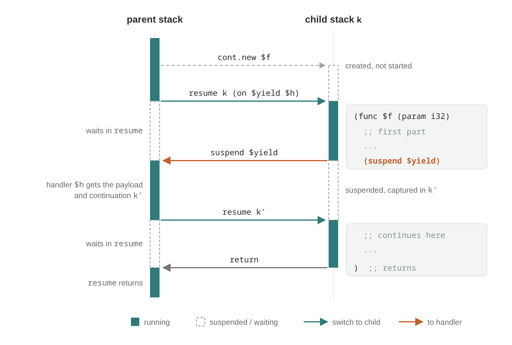

# WebAssembly: Stack Switching proposal

Recently, WebAssembly community introduced Stack Switching proposal,
supporting native non-local control flow. Light-weight threads,
async/await and generators can be compiled with WebAssembly effect handlers
without complicated program transformations.

Currently, WasmFX proposal is at stage 3 of standardization process.
It's supported as experimental feature in [V8](https://github.com/v8/v8) and [Wasmtime](https://github.com/bytecodealliance/wasmtime).

Proposal introduces the ability to jump between stacks and store
the execution state, when switching to another stack. So,
the execution of one's stack can be resumed later.

Core instructions introduced by the proposal are:
* `cont.new` - create a new suspended continuation (with a stack) from
  a function reference. When first resumed, function will start execution with
  the arguments given on stack.
* `resume` - runs a continuation as a child of the current stack,
  passing arguments and installing handlers for tags `(on $tag $label)`.
  It executes until `return` or `suspend` instructions.
* `suspend` - passes control to the nearest ancestor stack that
  handles `$tag`. The handler receives a new continuation for the
  suspended computation, which can be resumed later.



## Generator use case

This example is adapted from the proposal's
[explainer](https://github.com/WebAssembly/stack-switching/blob/main/proposals/stack-switching/Explainer.md#generators).

One can implement a generator, akin to `Sequence` or `Flow` in Kotlin. For the
generator the child stack is created. When element is requested, execution switches
to the generator stack and switches back with a calculated value as a payload.

`(tag $gen (param i32))` defines a payload of `i32` that will be passed from the
`suspend` instruction to the handler.

The following generator produces values from 100 to 1.
```webassembly
(func $generator
  (local $i i32)
  (local.set $i (i32.const 100))
  (loop $loop
    (suspend $gen (local.get $i)) ;; pass current value to the parent stack
    (local.tee $i (i32.sub (local.get $i) (i32.const 1)))
    (br_if $loop)
  )
)
```

On each iteration of the loop, `$generator` is suspended. By the `$gen` tag
current generator value is passed to the handler. After each resumption,
new value is calculated.

To create a generator and consume:
```webassembly
(func $consumer
  (local $c (ref $ct)) ;; (type $ct (cont $fn))
  (local.set $c (cont.new $ct (ref.func $generator)))

  (block $done
    (loop $loop
      (block $on_gen (result i32 (ref $ct))
        (resume $ct (on $gen $on_gen) (local.get $c))
        ;; $generator returned: exit the loop
        (br $done)
      )
      ;; $generator suspended: control continues after the $on_gen block
      ;; stack now contains a new continuation and produced value
      (local.set $c) ;; save the continuation for the next resume
      (call $print)  ;; print the produced value
      (br $loop)
    )
  )
  ;; execution continues here once the generator has finished
)
```

# Kotlin Coroutines

Kotlin introduces *suspend* functions: functions that may pause their execution
without blocking the caller and be resumed later from the same point. A suspension
can happen at the call sites of *suspend* functions - *suspension points*.
When a suspension happens, the special marker `COROUTINE_SUSPENDED` is returned by the function
and propagated up the call chain.

A coroutine is an instance of a suspendable computation. When it suspends, its
state — where to continue and the values of local variables — is captured in a
*Continuation* object, which is later used to resume execution.

With a dispatcher or an event loop, one can decide when to resume a
suspended execution and introduce asynchrony this way.

To execute a *suspend* function or a *suspend* lambda from a regular code, you can create a Coroutine
with `createCoroutine` and call `resume` on it, or start it right away with `startCoroutine`.

The universal way of coroutines compilation in all Kotlin backends is *continuation-passing
style* and *state machine* transformations. Each suspend function receives
an additional continuation parameter.

For each suspend function, the continuation object stores the execution state:
the current position and the local variables that are still needed after a suspension
point. Each suspension point checks the return value: if the `COROUTINE_SUSPENDED`
is returned, suspension unwinds the whole stack down to where the coroutine was started or
resumed. Otherwise, the execution runs until the next suspension point.

The `sequence { ... }` builder takes a suspend block with `yield` calls and returns a lazy
`Sequence<T>`. Iterating over it starts a coroutine that runs the block. Each `yield` stores the
value in the sequence's iterator, saves the continuation, and suspends; the next `hasNext()` call
resumes the coroutine to compute the next element.

Suppose, we want to have a Sequence builder that iterates over the binary tree left-to-right.
```kotlin
class Node(val left: Node?, val value: Int, val right: Node?)

suspend fun SequenceScope<Int>.visit(node: Node?) {
    if (node == null) return
    visit(node.left)
    yield(node.value)
    visit(node.right)
}

val values = sequence { visit(root) }
```

The simplified produced code for the `visit` function will be as following:

```kotlin
class VisitCOROUTINE(
    val receiver: SequenceScope<Int>,
    val node: Node?,                            // spilled: still needed after visit(node.left)
    resultContinuation: Continuation<Unit>,     // the caller's continuation
) : CoroutineImpl(resultContinuation) {
    fun doResume(): Any? {
        while (true) {
            when (state) {
                0 -> {
                    if (node == null) return Unit
                    state = 1
                    if (scope.visit(node.left, this) == COROUTINE_SUSPENDED) return COROUTINE_SUSPENDED
                }

                1 -> {
                    state = 2
                    if (scope.yield(node!!.value, this) == COROUTINE_SUSPENDED) return COROUTINE_SUSPENDED
                }

                2 -> {
                    state = 3
                    if (scope.visit(node!!.right, this) == COROUTINE_SUSPENDED) return COROUTINE_SUSPENDED
                }

                3 -> return Unit
            }
        }
    }
}
```

It has a loop with a state check. Depending on the state, it continues execution
from the specified point.

This transformation generates a lot of additional code: a class per suspend function,
state dispatch, and spilling of local variables. It is what makes Kotlin coroutines
*stackless*: a suspended coroutine has no stack of its own, its frames live on the heap
as a chain of continuation objects, and the native stack is unwound on every suspension.

This also makes debugging harder: after a resumption, the native stack contains only the
frames from the resumption point, so stack traces and debuggers do not show the logical
call chain of the coroutine.

## Kotlin Coroutines with WasmFX

Kotlin coroutines align closely with the *WasmFX* primitives.
With stack switching, each coroutine stores a WebAssembly continuation.
Suspending and resuming a Kotlin coroutine map almost directly
to the `suspend` and `resume` instructions. Creating a coroutine
is done with `cont.new`.

Suspend functions no longer need a state machine transformation:
a call to suspend functions from another suspend function
is a regular Wasm `call`, executed on the coroutine's Wasm stack.

This way, `visit` function keeps its original body.
Only the `completion` argument is added.

```kotlin
fun SequenceScope<Int>.visit(node: Node?, completion: Continuation<Unit>) {
    if (node == null) return
    visit(node.left)
    yield(node.value)
    visit(node.right)
}
```

Suspension happens in the `yield` method, after it stores the next sequence value.

```webassembly
;; SequenceBuilderIterator.yield, compiled with stack switching (simplified)
(func $SequenceBuilderIterator.yield
    (param $this (ref $SequenceBuilderIterator))
    (param $value anyref)
    (param $completion (ref $Continuation))
  ;; nextValue = value
  (struct.set $SequenceBuilderIterator $nextValue (local.get $this) (local.get $value))
  ;; nextStep = completion: the next hasNext() resumes through it
  (struct.set $SequenceBuilderIterator $nextStep (local.get $this) (local.get $completion))
  ;; switch back to the iterator's stack; execution continues here when resumed
  (suspend $tag)
  ;; ...
)
```

### This design eliminates the costs of the state machine transformation:
* **Smaller binaries:** no generated classes for suspend functions, state dispatch,
or spilling per suspend function.
[Optimized binaries for [KotlinConf App](https://github.com/jetbrains/kotlinconf-app) are 6% smaller.]
* **Less allocation:** calling a suspend function no longer allocates a continuation object.
* **Real stack traces:** WebAssembly continuations preserve their stack, so
debuggers show the actual code chain.
* **Lighter compilation:** mapping resume and suspend instructions does not require complicated program transformations and optimizations.

## What's next

Smaller binaries and simpler code are only half of the story. Stack switching moves the cost
of coroutines from compiled code into the engine: every coroutine now owns a stack, and every
suspension is a switch between stacks. The performance now completely depends on how
engines implement these operations.

In the next post, I'll compare Kotlin coroutines on *WasmFX* with the state machine
compilation in **V8** and **Wasmtime**.

[//]: # (`suspend` function modifiers in Kotlin delimit code into blocking and suspendable.)


[//]: # ()
[//]: # (This is the first post. Remove `draft: true` above to publish it.)

[//]: # ()
[//]: # (I'll write about compilers, WebAssembly, and Kotlin.)
